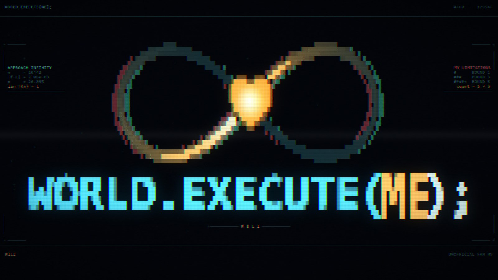
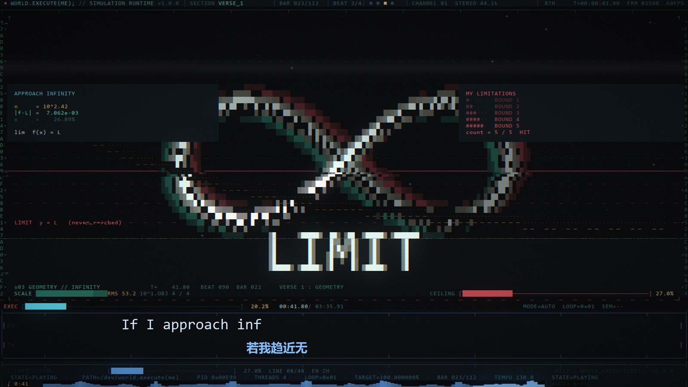
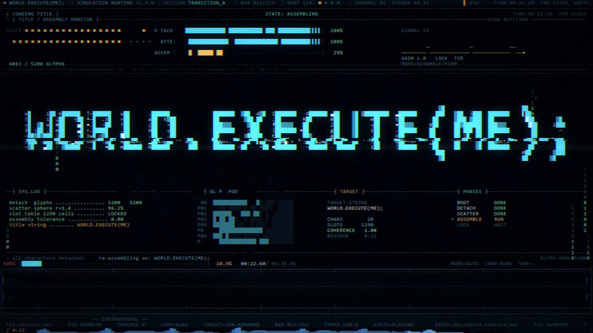
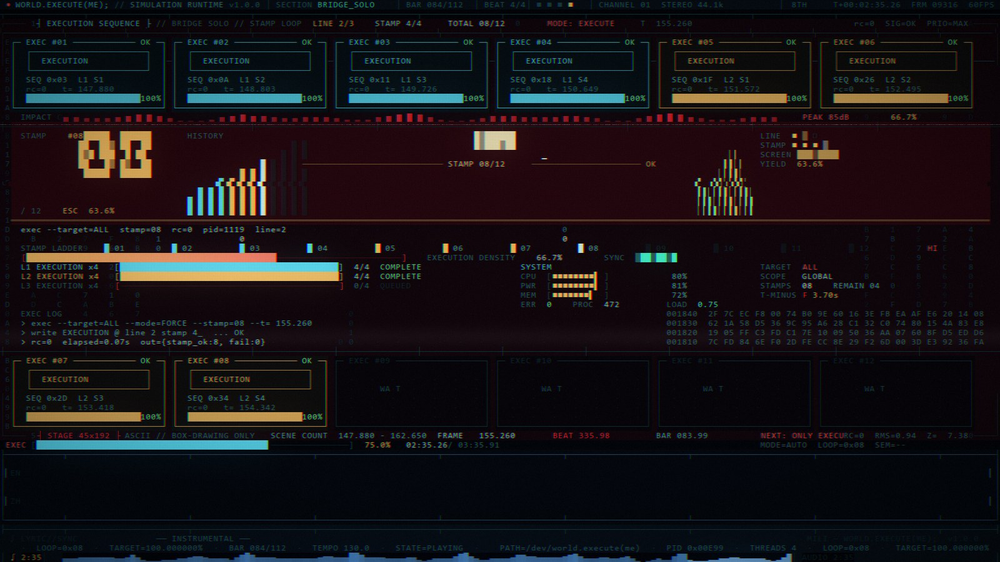
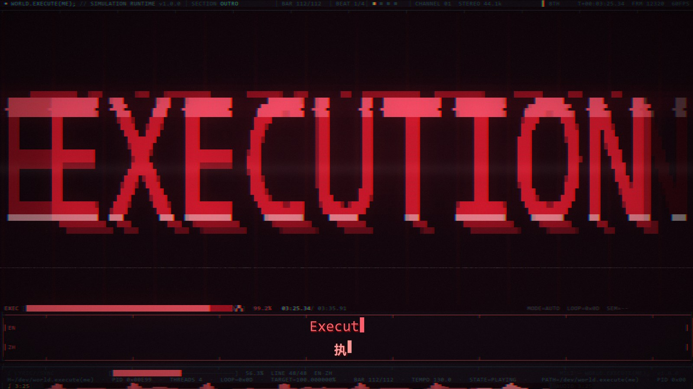
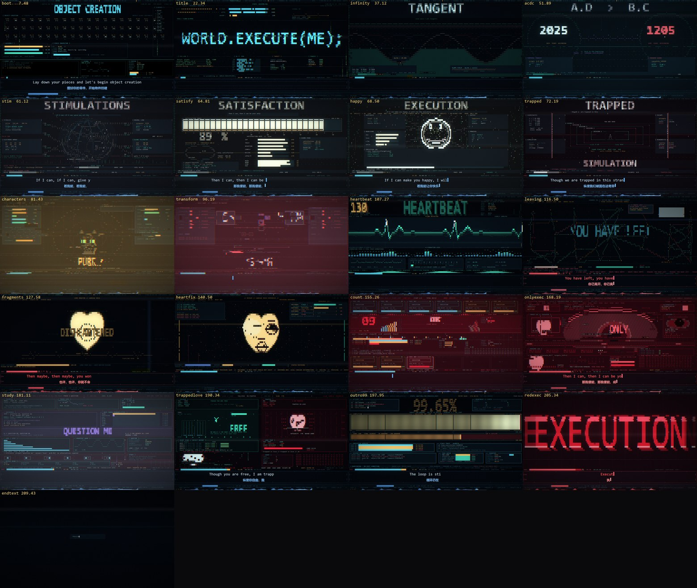
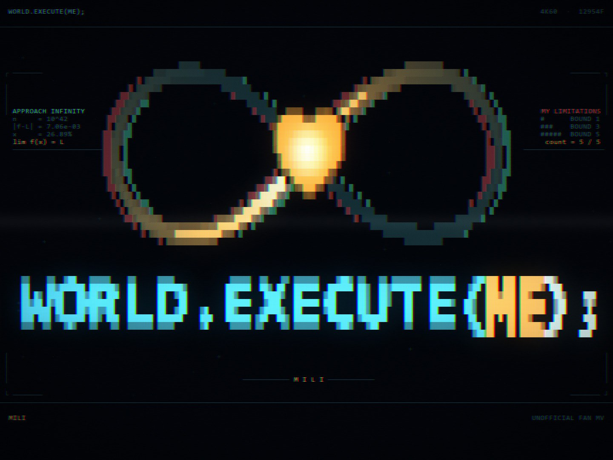

<div align="center">

# world.execute(me); — ASCII 终端 MV

**12954 帧 · 3840×2160 · 60 fps · 没有一帧是素材**

每一帧都是 Python 在这个 **192×60 的字符网格**上现画的：字符、颜色、扫描线，
外加一套从零写的渲染引擎。没有视频素材、没有 AI 生成图、没有剪辑软件。

[▶ 成片（B站）](#) · [截图](#截图) · [创作提示词](docs/prompts/creation-prompts.md) · [快速开始](#快速开始) · [架构](docs/ARCHITECTURE.md)

</div>



## 创作提示词

整理了这支 MV 从终端播放器到 4K60 视频线、再到封面与开源的 **12 轮提示词**，以及一份方便复用的合并版。

- **[在线阅读创作过程](docs/prompts/creation-prompts.md)**：按轮次查看需求、场景位置与修改方向，文内目录可直接跳转。
- **[直接查看合并提示词](docs/prompts/creation-prompts.md#combined-prompt)**：适合整体阅读和复制使用。
- **[纯文本版](docs/prompts/creation-prompts.txt)**：方便保存到本地或在文本编辑器中打开。

更早的 25 轮（终端播放器形态）在姊妹仓库 [yym8224961/world.execute-me-ascii](https://github.com/yym8224961/world.execute-me-ascii/blob/main/docs/prompts/creation-prompts.md)。

---

## 这是什么

一支给 Mili《world.execute(me);》做的 **非官方同人 MV**（约 3 分 36 秒），
把整首歌画成一台正在运行自己的机器：点阵开机、标题被字符风暴重组、几何与 ∞、
AC→DC 整流、神经刺激、满意度评分、心跳、碎片、永远差一点的进度条，
最后收在一句打出来的黑屏字幕。

| | |
|---|---|
| 画布 | 192×60 字符格（舞台 45×192，其余留给 chrome） |
| 分辨率 | 3840×2160 @ 60 fps（母版），也可 1920×1080 |
| 长度 | 215.905 s（正片 211.905 s + 4 s 尾留白），130 BPM |
| 帧数 | 12954 |
| 场景 | 21 个，各自实现 `draw(ctx) -> Frame` |
| 依赖 | Python + numpy + Pillow + ffmpeg；字体需自备（见 `fonts/`） |
| 代码量 | 约 3 万行 Python（引擎 + 21 场景 + 工具链） |

## 截图


*41.8 s — 无限符号不再放大吞屏，而是一条光带绕着曲线跑*


*22.6 s — 满屏代码风暴从界面上掠过、回落成标题，原来的 UI 一直在下面*


*155.3 s — 报数段：DE/ES/FR/KO/PT/ZH 六种语言的数字轮转*


*205.3 s — 全片唯一一次真正的 EXECUTION*

<details>
<summary><b>21 个场景一览（点开看拼图）</b></summary>



</details>

## 快速开始

```bash
git clone https://github.com/<owner>/world-execute-ascii
cd world-execute-ascii
pip install -r requirements.txt          # numpy + Pillow
# ffmpeg 需要在 PATH 里（或 export FFMPEG=/path/to/ffmpeg）
```

**1）先看一张静帧**（不需要音频、不需要 ffmpeg）：

```bash
python tools/still.py --t 41.8 --out out/still.png                 # 1080p
MV_SCALE=2 python tools/still.py --t 41.8 --out out/still4k.png    # 4K
python tools/still.py --scene all --n 1 --sheet out/sheet.png      # 21 场景拼图
```

**2）在终端里直接播放**（192 列 × 60 行的终端）：

```bash
python bin/asciimv.py                # 需要 audio/song.wav（见下）
```

**3）渲染完整视频**：

```bash
# 放进你自己的音频（版权原因仓库不含歌曲）
cp /path/to/world.execute.me.wav audio/song.wav
python tools/build_assets.py                 # 频谱 / 节拍特征 -> audio/*.npz

python tools/render.py --workers 8 --out out/video_1080.mp4        # 1080p 无声
python tools/render_subs.py                                        # 字幕 PNG 序列
python tools/compose_subs.py --base out/video_1080.mp4 \
       --subs "out/subs/%05d.png" --out out/video_1080_subbed.mp4  # 烧字幕
python tools/encode.py --video out/video_1080_subbed.mp4 \
       --audio audio/song.wav --out out/final_1080.mp4             # 混音轨
```

4K 母版是同一套命令加 `MV_SCALE=2`；分帧重渲、拼接、像素比对那套流程见
[`docs/RENDERING.md`](docs/RENDERING.md)。

## 它是怎么搭的

```
engine/
  layout.py     192×60 网格、45 行舞台、10×18 px 格子、60 fps、总时长
  font.py       字符 -> 覆盖率掩码（自己光栅化，带 1px 腐蚀，让细笔画扛得住 CRT 后处理）
  frame.py      Frame：字符 + 每格前景/背景色，paint_mask / paint_text / box / compose
  palette.py    调色板与 17 级色阶
  widgets.py    面板、进度条、折线、表盘…… 画在字符网格上的小部件
  art.py        心形 / ∞ / 番茄 / 鲸鱼等造型的掩码
  fx.py         抖动、溶解、扫描、色散
  timeline.py   歌词与时间码（字幕的唯一来源）
  sceneapi.py   场景调度：SCHEDULE + SceneCtx（t / beat / bar / 声纹 / meta）
  scenes/       21 个场景，每个只负责画 45×192 的舞台
  chrome.py     舞台之外的一切：页眉、走带条、字幕条、页脚频谱
  post.py       CRT 后处理：扫描线、孔径、暗角、色散、噪点、闪白
bin/asciimv.py  终端播放器（同一套引擎，直接输出 ANSI）
tools/          still / render / render_subs / compose_subs / mux_sfx / cover / check_timeline …
docs/           ARCHITECTURE（帧生命周期）/ RENDERING（4K 管线）/ SCENE_API（写场景）/ prompts（创作提示词）
```

图层顺序是固定的：**场景画舞台 → chrome 加边框和字幕 → post 加 CRT → 编码**。
场景永远不碰页眉和字幕条，所以换 chrome、换字幕不会影响任何场景代码。


*同一套设计、原生 4:3 版面（`tools/cover_aspect.py --aspect 4x3`）*

## 21 个场景

| # | 时间 (s) | 场景 | 一句话 |
|---|---|---|---|
| s01 | 0.000–14.960 | `boot` | 机器通电：字符点阵自检、进度条、开机自述 |
| s02 | 14.960–29.730 | `title` | 界面被打散成 5200 个字模，再重组为 `WORLD.EXECUTE(ME);` |
| s03 | 29.730–44.500 | `infinity` | 几何：点 / 圆 / 正弦 / 极限，收在固定大小、光带环流的 ∞ |
| s04 | 44.500–59.270 | `acdc` | “switch my current, AC→DC”：整流桥把正弦折成直流 |
| s05 | 59.270–62.962 | `stim` | 神经刺激：电极阵列、两条 spike train、脉冲打进旋转地球 |
| s06 | 62.962–66.654 | `satisfy` | 满意度评分板：渴望 / 忠诚 / 信任一起涨到 SATISFIED |
| s07 | 66.654–70.347 | `happy` | 快乐执行：所有指标都只输出同一个答案 |
| s08 | 70.347–74.040 | `trapped` | 仿真网格、墙在收拢、诊断读数烂成乱码 |
| s09 | 74.040–88.810 | `characters` | 四种物质形态，各自一段大字符动画 |
| s10 | 88.810–103.580 | `transform` | 每两小节一次变身，满屏高频运动 |
| s11 | 103.580–110.964 | `heartbeat` | 心电监护：整屏一条波形 |
| s12 | 110.964–122.041 | `leaving` | 网络一条边一条边断开，最后只剩一个节点 |
| s13 | 122.041–133.110 | `fragments` | 记忆被擦除、心碎成两半、质问“神” |
| s14 | 133.110–147.880 | `heartfix` | 纯音乐段：把心重新造出来，逐个补上缺陷 |
| s15 | 147.880–162.650 | `count` | `EXECUTION ×4` 蓄力，然后六种语言报数 |
| s16 | 162.650–173.727 | `onlyexec` | 病娇段：只剩 EXECUTION、只有你 |
| s17 | 173.727–188.496 | `study` | 一个“如何好好爱你”的机器学习 demo，然后崩了 |
| s18 | 188.496–192.190 | `trappedlove` | “你自由了，我困在爱里” |
| s19 | 192.190–203.720 | `outro99` | 永远停在 99.65% 的完成度 |
| s20 | 203.720–206.960 | `redexec` | 全片唯一一次真正的 EXECUTION |
| s21 | 206.960–211.905 | `endtext` | 机器安静下来，只剩一句打出来的字和一个光标 |

## 用 AI agent 一起做

这支 MV 的生产过程是“人给意图、agent 写场景、静帧验收”的循环：21 个场景各写各的，
每个场景先用 `tools/still.py` 出静帧人工点头，再进渲染队列。方法论、模板与验收标准整理在
[`docs/prompts/method.md`](docs/prompts/method.md)，可以直接当模板喂给别的 agent 去改这支 MV，
或者做你自己的那支。

## 换成你自己的歌

1. `engine/timeline.py` — 歌词、时间码、场景分界（唯一的时间真相）
2. `audio/beats.json` — 节拍网格（`tools/build_assets.py` 会读它）
3. `engine/sceneapi.py` 的 `SCHEDULE` — 场景顺序与时长
4. `engine/scenes/*.py` — 每个场景独立，可以整个换掉
5. `engine/palette.py` — 换一套配色就是另一种气质

## 已知限制

- **字体**：原画用的是 Consolas / 微软雅黑 / Malgun Gothic（专有字体，不含在仓库里）。
  引擎会在系统字体目录里找替代字体，Linux 上会用 DejaVu / Noto，字形略有差别。
- **引擎以 1080p 为基准**：`MV_SCALE=2` 时格子翻倍，但 `post.py` 里有几处像素级常量
  是按 1080p 手调的，换比例需要复看。
- `s04`–`s08` 的字符栅格辅助函数是各自复制的一份（历史原因），
  提取成 `engine/cellraster.py` 是 roadmap 上的第一步。
- 4K 渲染吃 CPU：12 核机器上 1080p 约 1.7 fps/worker，4K60 整片约 90 分钟。

## 许可

| 内容 | 许可 |
|---|---|
| 代码（`engine/` `tools/` `bin/`） | MIT — [LICENSE](LICENSE) |
| 画面（`media/`、渲染出的静帧与成片） | CC BY-NC-SA 4.0 — [LICENSE-ART](LICENSE-ART) |
| 歌曲、歌词、字体 | **不随仓库分发**，权利归原权利人 — [NOTICE.md](NOTICE.md) |

**这是非商业同人作品**：音乐与歌词版权归 **Mili**。仓库不含音频；
字幕里的歌词仅用于这支非商业 MV。若你是权利人希望移除，请开 issue，24 小时内处理。

---

<details>
<summary><b>English</b></summary>

### world.execute(me); — an ASCII terminal music video

A 3:36 unofficial fan MV for Mili's *world.execute(me);*, rendered entirely by a
hand-written Python engine on a **192×60 character grid**: 12,954 frames at
3840×2160 / 60 fps. No footage, no generated images, no editing software — every
pixel is a glyph plus a colour, then hit with a CRT pass.

- 21 self-contained scenes, each implementing `draw(ctx) -> Frame` (45×192 stage)
- the chrome (header, transport bar, subtitles, footer spectrum) is a separate
  layer, so scenes never touch the subtitle strip
- the same engine drives a terminal player (`bin/asciimv.py`)

Quick start: `pip install -r requirements.txt`, drop your own copy of the song at
`audio/song.wav` (the audio is **not** included — it is Mili's), then
`python tools/render.py`. Stills need neither audio nor ffmpeg:
`python tools/still.py --t 41.8 --out out/still.png`.

Code MIT · artwork CC BY-NC-SA 4.0 · song/lyrics/fonts not distributed.
See [NOTICE.md](NOTICE.md).

</details>
